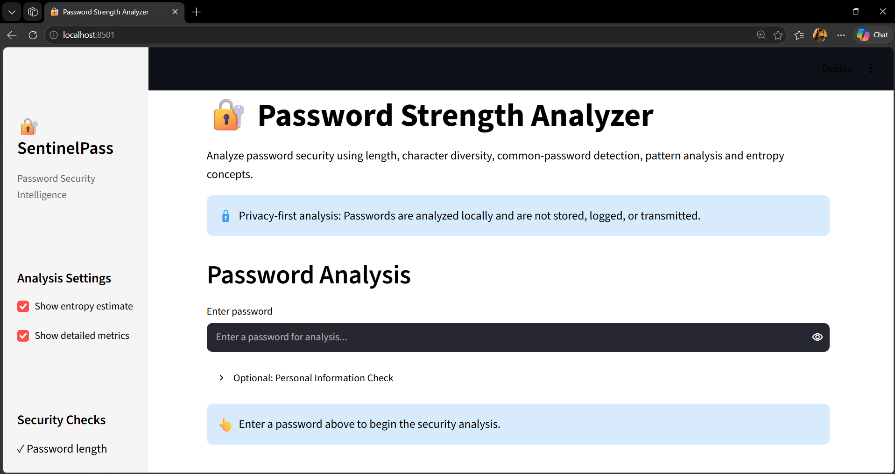
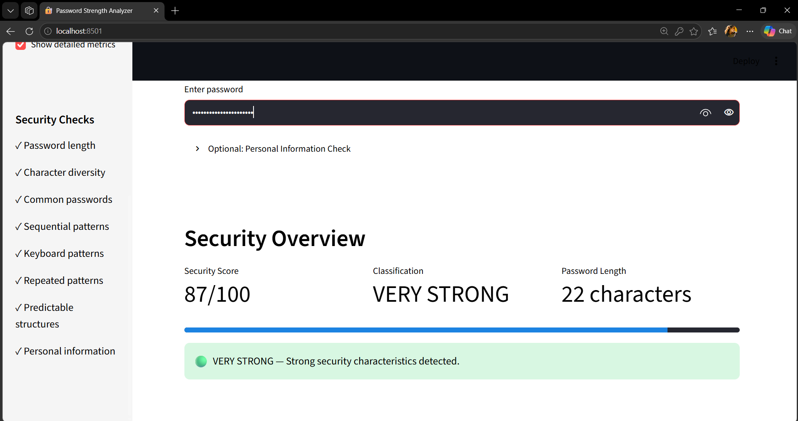
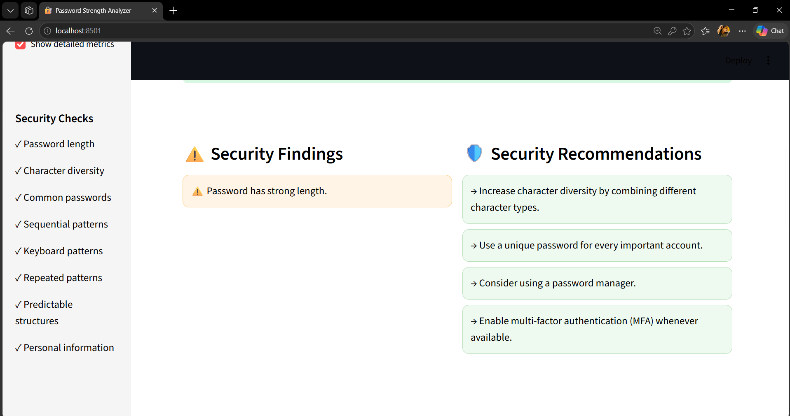
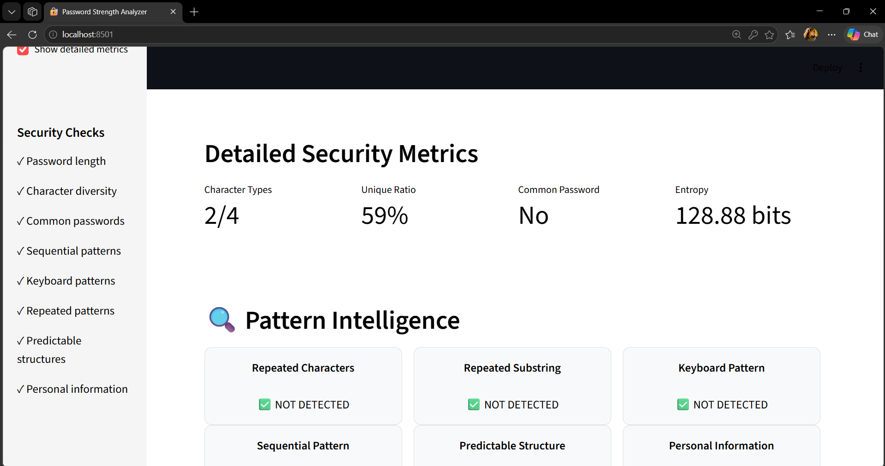
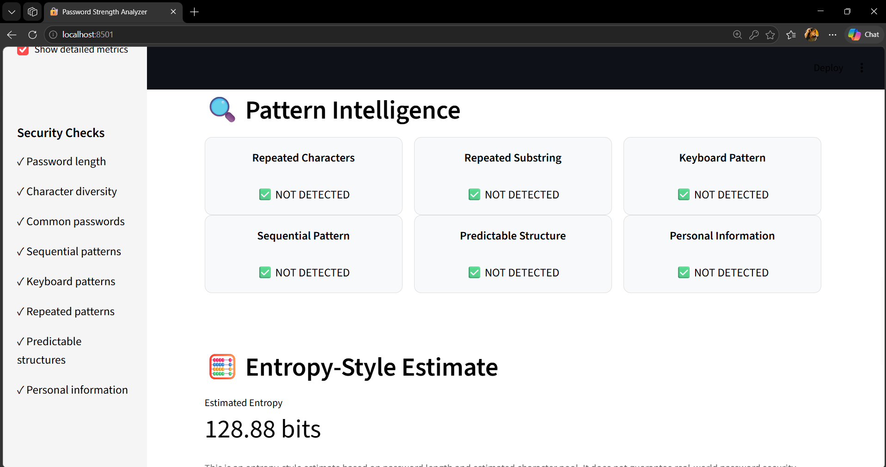
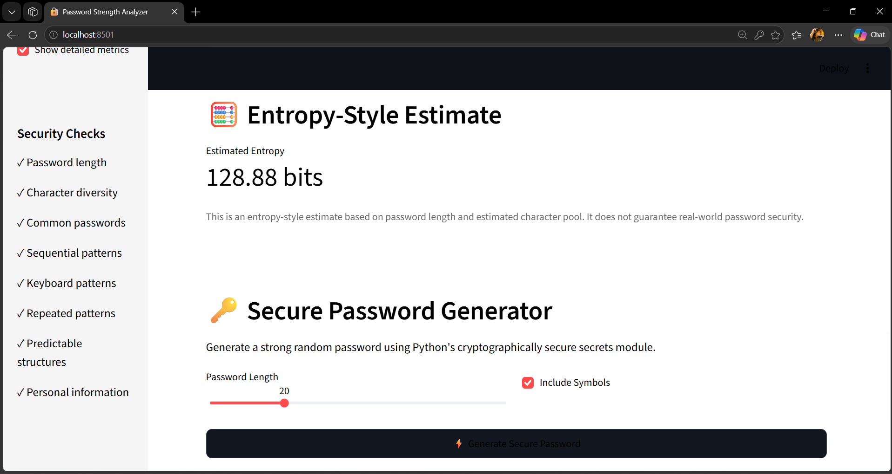

# 🔐 Password Strength Analyzer & Security Suggestion Tool

A privacy-focused cybersecurity application built with **Python and Streamlit** that evaluates password strength using length, character diversity, predictability, common-password detection, pattern analysis, and entropy concepts.

The tool provides actionable security recommendations to help users create stronger and more secure passwords without storing or transmitting plaintext passwords.

---

## 📌 Overview

Weak and predictable passwords remain one of the major risks in authentication security. Many password-strength checkers rely only on simple rules such as uppercase letters, numbers, and special characters.

This project takes a broader approach by analyzing:

* Password length
* Character diversity
* Unique-character ratio
* Repeated characters and substrings
* Sequential patterns
* Keyboard patterns
* Common passwords
* Predictable structures
* Year/date-like patterns
* Entropy-style estimates
* Overall password strength
* Security recommendations

The application is designed as a **defensive cybersecurity and security-awareness tool**.

> ⚠️ **Privacy principle:** Passwords are analyzed locally and are not intentionally stored, logged, or transmitted by the application.

---

## 🎯 Problem Statement

Users frequently create passwords that are short, reused, predictable, or based on common words and patterns.

Traditional password-strength indicators may incorrectly consider a password strong simply because it contains uppercase letters, numbers, and symbols.

This project addresses the problem by combining **length, unpredictability, pattern resistance, common-password detection, and security-awareness recommendations** into a single interactive application.

---

## 🚀 Objectives

* Analyze password strength locally.
* Detect common and predictable passwords.
* Identify sequential and keyboard patterns.
* Detect repeated characters and substrings.
* Measure character diversity and uniqueness.
* Provide an entropy-style estimate.
* Generate actionable security recommendations.
* Encourage longer passwords and passphrases.
* Demonstrate secure password-analysis concepts.
* Promote password-manager and MFA usage.
* Follow privacy-focused password handling principles.

---

## 🛡️ Cybersecurity Relevance

This project demonstrates concepts related to:

* Cybersecurity
* Application Security
* Authentication Security
* Identity and Access Management (IAM)
* Secure Coding
* Password Security
* Security Awareness
* Pattern Detection
* Entropy Concepts
* Defensive Security

The project does **not** perform password cracking, credential attacks, account attacks, or credential harvesting.

---

## ✨ Key Features

### 🔎 Password Strength Analysis

The application analyzes passwords and classifies them into:

|  Score | Classification |
| -----: | -------------- |
|   0–20 | 🔴 VERY WEAK   |
|  21–40 | 🟠 WEAK        |
|  41–60 | 🟡 MODERATE    |
|  61–80 | 🟢 STRONG      |
| 81–100 | 🔵 VERY STRONG |

---

### 📏 Length Analysis

Password length contributes significantly to the overall score.

The application considers:

* Less than 8 characters → Very short
* 8–11 characters → Short
* 12–15 characters → Better
* 16+ characters → Strong length contribution

Longer passwords and passphrases are encouraged because length substantially increases the search space.

---

### 🔤 Character Diversity

The analyzer checks for:

* Lowercase letters
* Uppercase letters
* Digits
* Symbols

It also calculates the number of character types used.

---

### ♻️ Repetition Detection

The application detects:

* Repeated characters
* Repeated substrings
* Highly repetitive structures

Examples:

```text
aaaaBBBB1111
abcabcabc
11111111
```

---

### 🔢 Sequential Pattern Detection

Predictable sequences are identified, including patterns such as:

```text
1234
abcd
9876
dcba
```

This helps identify passwords that appear complex but remain predictable.

---

### ⌨️ Keyboard Pattern Detection

Common keyboard sequences are detected, such as:

```text
qwerty
asdf
zxcv
qwerty123
```

Keyboard-based passwords are commonly predictable and therefore receive appropriate penalties.

---

### 🔑 Common Password Detection

The application checks passwords against a local common-password list.

Examples include:

```text
password
password123
123456
12345678
qwerty
letmein
welcome
admin
```

No external password database is required for the core analysis.

---

### 📊 Entropy-Style Estimate

The project provides an entropy-style estimate using the concept:

```text
Entropy ≈ L × log₂(N)
```

Where:

* `L` = password length
* `N` = estimated character pool size

The entropy value is intended as an educational estimate.

> **Important:** Real human-created passwords are not truly random, so entropy calculations alone cannot accurately represent real-world password security.

---

### 🧠 Predictability Analysis

The analyzer identifies predictable structures such as:

* Common password words
* `password123`
* `admin123`
* `welcome123`
* Year-like patterns
* Letter + number combinations
* Predictable prefixes and suffixes

---

## 📈 Strength Scoring

The scoring system combines multiple security characteristics.

| Component                   | Maximum Contribution |
| --------------------------- | -------------------: |
| Length                      |                   35 |
| Character Diversity         |                   15 |
| Unique Character Ratio      |                   10 |
| Pattern Resistance          |                   20 |
| Non-Common Password         |                   10 |
| Additional Unpredictability |                   10 |
| **Total**                   |              **100** |

Penalties may be applied for:

* Common passwords
* Sequential patterns
* Keyboard patterns
* Repetition
* Predictable structures
* Personal-information patterns when supplied

---

## 💡 Security Recommendations

The tool provides recommendations based on detected weaknesses.

Examples:

* Use a longer password or passphrase.
* Consider using 16 or more characters.
* Avoid numeric and alphabetic sequences.
* Avoid common passwords.
* Avoid keyboard patterns such as `qwerty`.
* Avoid predictable information such as names or years.
* Use a unique password for every important account.
* Consider using a password manager.
* Enable Multi-Factor Authentication (MFA).

---

## 🔐 Privacy-Focused Design

Privacy is a core design principle of this project.

### The application is designed to:

✅ Analyze passwords locally
✅ Avoid storing plaintext passwords
✅ Avoid logging plaintext passwords
✅ Avoid transmitting passwords externally
✅ Use local common-password data
✅ Use synthetic passwords for testing and demonstrations

### The application should never be used to:

❌ Collect real user passwords
❌ Capture credentials
❌ Crack passwords
❌ Attempt unauthorized account access
❌ Transmit passwords to third-party services

---

## 🏗️ Project Architecture

```text
Password-Strength-Analyzer-Security-Tool/
│
├── app.py
│
├── utils/
│   └── analyzer.py
│
├── data/
│   └── common_passwords.txt
│
├── tests/
│   └── test_analyzer.py
│
├── screenshots/
│   ├── screenshot1.png
│   ├── screenshot2.png
│   ├── screenshot3.png
│   ├── screenshot4.png
│   ├── screenshot5.png
│   └── screenshot6.png
│
├── requirements.txt
├── .gitignore
└── README.md
```

---

## ⚙️ Technology Stack

| Technology   | Purpose                             |
| ------------ | ----------------------------------- |
| Python       | Core programming language           |
| Streamlit    | Interactive web application         |
| Pandas       | Data handling                       |
| Plotly       | Visualization support               |
| Pytest       | Automated testing                   |
| Git & GitHub | Version control and project hosting |

---

## 📂 Core Components

### `app.py`

The Streamlit application interface responsible for:

* User interaction
* Password analysis display
* Strength classification
* Metrics
* Recommendations
* Security information

### `utils/analyzer.py`

Contains the core password-analysis logic:

```python
analyze_password(password)
```

The function returns:

```text
score
classification
findings
suggestions
metrics
```

### `data/common_passwords.txt`

Contains a local educational list of commonly used passwords for detection.

### `tests/test_analyzer.py`

Contains automated tests covering:

* Common password detection
* Strong password classification
* Length analysis
* Sequence detection
* Repeated-character detection

---

## 🧪 Testing

The project uses **Pytest** for automated testing.

Current test suite:

```text
5 tests passed
```

Tested functionality includes:

* Common password detection
* Strong password detection
* Password length analysis
* Sequential pattern detection
* Repeated-character detection

Example command:

```powershell
python -m pytest
```

Expected result:

```text
5 passed
```

---

## 🖥️ Screenshots

### Application Interface



### Password Analysis



### Strength Classification



### Security Findings



### Recommendations



### Detailed Metrics



---

## 🚀 Installation

### 1. Clone the repository

```bash
git clone https://github.com/YOUR-USERNAME/Password-Strength-Analyzer-Security-Tool.git
cd Password-Strength-Analyzer-Security-Tool
```

### 2. Create a virtual environment

```bash
python -m venv .venv
```

### 3. Activate the environment

**Windows PowerShell:**

```powershell
.\.venv\Scripts\Activate.ps1
```

### 4. Install dependencies

```bash
pip install -r requirements.txt
```

### 5. Run the application

```bash
streamlit run app.py
```

The application will open in your browser.

---

## 🧪 Example Test Passwords

For demonstration purposes only:

| Password                  | Expected Observation            |
| ------------------------- | ------------------------------- |
| `123456`                  | Very weak / common / sequential |
| `password123`             | Common / predictable            |
| `qwerty123`               | Keyboard / predictable          |
| `abcd1234`                | Sequential pattern              |
| `aaaaBBBB1111`            | Repetition                      |
| `River!Cloud#92Moon$Tree` | Strong candidate                |

> Never use real personal passwords in screenshots, demonstrations, or testing.

---

## 🔮 Future Improvements

Potential future enhancements include:

* Secure password generator using Python `secrets`
* Password policy checker
* Aggregate privacy-safe analytics
* Strength distribution charts
* Common weakness analytics
* API-based architecture
* Authentication security demonstrations
* Secure password hashing demonstrations
* MFA-awareness module
* Expanded dictionary detection
* Personal-information detection
* Security dashboard
* More comprehensive automated security tests

---

## ⚠️ Limitations

* Entropy is an estimate and does not represent true human password randomness.
* Pattern detection cannot identify every possible predictable password.
* A high score does not guarantee that a password has never been compromised.
* Common-password detection depends on the locally available password list.
* Password strength analysis should be combined with secure authentication architecture.

Real-world authentication systems should additionally use:

* Strong password hashing
* Salting
* MFA
* Rate limiting
* Account abuse protection
* Secure session management
* Phishing-resistant authentication where appropriate
* Monitoring and incident response

---

## 🎓 Learning Outcomes

Through this project, the following concepts were explored:

* Password security
* Authentication security
* Secure coding principles
* Python application development
* Streamlit development
* Pattern recognition
* Password entropy concepts
* Defensive cybersecurity
* Automated testing
* Privacy-aware application design
* Security awareness

---

## 🛡️ Security Disclaimer

This project is developed for **educational, defensive cybersecurity, and security-awareness purposes**.

It is not a password-cracking tool and should not be used to obtain, test, or attack credentials belonging to other individuals or systems.

Always use **synthetic or test passwords** when demonstrating the application.

---

## 👩‍💻 Author

**Sai Hema**

B.Tech Computer Science Engineering | AI/ML & Cybersecurity Enthusiast

Focused on building practical projects in:

* Artificial Intelligence
* Machine Learning
* Data Science
* Cybersecurity
* Full-Stack Development

---

## ⭐ Acknowledgement

Special thanks to **my mentor, Umesh Yadav Sir**, for his valuable guidance, encouragement, and continuous support in helping me explore practical technology and cybersecurity projects.

---

## ⭐ If You Find This Project Useful

Consider giving the repository a ⭐ on GitHub and sharing it with others interested in cybersecurity, secure coding, and password security.
